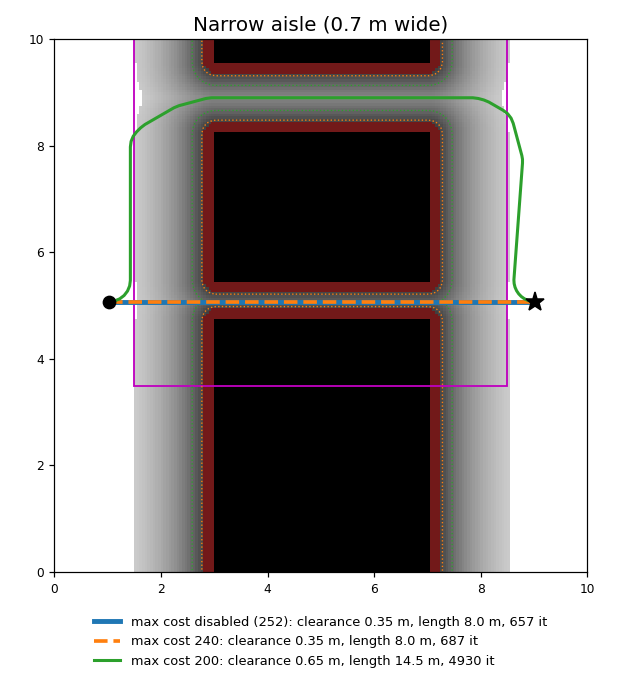

# Lyrical to M-Turtle { #lyrical-to-m-turtle }

## Migration Actions and Deprecations

### Transform Manager API

[PR #6651](https://github.com/ros-navigation/navigation2/pull/6651) introduces `nav2::TransformManager` to simplify and standardize how Nav2 receives, looks up, and broadcasts frame transforms. Transformation lookups can be either the latest available or at a specific timestamp. This reduces repeated TF2 boilerplate and creates consistency in how transforms are handled.

Note that this is a breaking API change: custom components, including behavior tree nodes, that previously accepted a TF buffer must update their interfaces to use `nav2::TransformManager` instead.


| New `nav2::TransformManager` API | Previous API | When to use it |
| --- | --- | --- |
| `getLatestPose(target_frame, source_frame, staleness_threshold)` | `nav2_util::getCurrentPose()` with a zero stamp or `nav2_util::getFreshPose()` | Get the latest robot or other frame pose, with an optional age limit. |
| `getLatestTransform(target_frame, source_frame, staleness_threshold)` | `nav2_util::getTransform()`, `nav2_util::lookupTransformWithStalenessCheck()`, or `lookupTransform()` with time zero | Get the latest available transform between frames, with an optional age limit. |
| `getStampedTransform(target_frame, source_frame, stamp, transform_tolerance)` | `lookupTransform()` at a specified time | Transform sensor data or computed results at their timestamp. |
| `getStampedTransform(target_frame, target_time, source_frame, source_time, fixed_frame, transform_tolerance)` | The corresponding two-time `nav2_util::getTransform()` or advanced `lookupTransform()` overload | Express an earlier observation in a frame at a later time, accounting for robot motion through a fixed frame such as `odom`. |
| `transformStampedPose(target_frame, input_pose, transform_tolerance)` | `nav2_util::transformPoseInTargetFrame()` or `transform()` | Express an arbitrary stamped pose in another frame at the pose's timestamp. |
| `sendTransform(transform)` or `sendStaticTransform(transform)` | A separate `tf2_ros::TransformBroadcaster` or `tf2_ros::StaticTransformBroadcaster` | Publish dynamic or static transforms. |
| `transformToPoseStamped()`, `poseToTransformStamped()`, or `invertTransform()` | The same functions in `nav2_util` | Convert between pose and transform messages, or invert a transform; these are static methods and do not look up TF. |

Choose **Latest** for a current frame relationship, such as the robot pose used for control. These lookups use the latest common time in the TF chain and do not wait for unavailable TF. Supply a positive `staleness_threshold` to reject outdated dynamic transforms.

Choose **Stamped** when transforming data recorded or computed at a particular time, so motion since that time does not distort its placement. These lookups can wait up to `transform_tolerance` (a `double` in seconds) for the required TF; this is a wait timeout, not an allowance for timestamp error or extrapolation. They do not check age against the current time. A zero stamp requests the latest common time without an age check. See the [Transform Synchronization Strategy][transform-synchronization-strategy] for guidance on preserving timestamps.

Lookup methods return `std::optional`; check the result before using it and handle failures in the caller. They do not log failures automatically. Supply an optional `std::string * error_msg` as the final argument to receive diagnostic details. For points, point clouds, and other message types, obtain the appropriate transform from the manager and apply it with `tf2::doTransform`.

The manager receives TF on a dedicated listener thread by default. For a broadcaster-only manager, pass `activate_listener=false` to the factory. Only for native TF integrations that require a `tf2_ros::Buffer`, such as `laser_geometry`, use `getRawBuffer()`. Pass the manager to `nav2::create_message_filter()` for TF-aware subscriptions.

### Behavior Server plugin parameters are now namespaced

The behavior plugins' parameters are now declared under the plugin's name from `behavior_plugins`, in the same way the `acceleration_limit`, `deceleration_limit` and `minimum_speed` parameters of `BackUp` and `DriveOnHeading` already were. The old node-level names are no longer read, so existing configurations must be updated or the defaults will silently apply:

| Old (node-level)       | New (per plugin)                                                     |
|------------------------|----------------------------------------------------------------------|
| `simulate_ahead_time`  | `spin.simulate_ahead_time`, `backup.simulate_ahead_time`, `drive_on_heading.simulate_ahead_time` |
| `max_rotational_vel`   | `spin.max_rotational_vel`                                            |
| `min_rotational_vel`   | `spin.min_rotational_vel`                                            |
| `rotational_acc_lim`   | `spin.rotational_acc_lim`                                            |
| `projection_time`      | `assisted_teleop.projection_time`                                    |
| `simulation_time_step` | `assisted_teleop.simulation_time_step`                               |
| `cmd_vel_teleop`       | `assisted_teleop.cmd_vel_teleop`                                     |

Substitute your own plugin names if they differ from the defaults. Simply move the parameter under the plugin's declaration in your configuration.

### Single Lifecycle Manager in Nav2 Bringup

[PR #6410](https://github.com/ros-navigation/navigation2/pull/6410) combines the separate lifecycle managers for localization, navigation, SLAM, keepout zones, speed zones and the loopback simulator into a single `lifecycle_manager_nav2`, started by `bringup_launch.py`. Measured on the Turtlebot 4 simulation launch, which previously ran four lifecycle managers, this reduces Nav2's CPU use by around 25%. The nested launch files in `nav2_bringup` no longer start a lifecycle manager of their own. Each has a `get_lifecycle_nodes(context)` function that returns its lifecycle node names, which `bringup_launch.py` collects into the `node_names` of the single manager.

Launching a nested file by itself, such as `ros2 launch nav2_bringup navigation_launch.py`, now leaves the servers unconfigured. Launch `bringup_launch.py` instead and use its arguments to turn off what you do not need, for example `use_localization:=False` when SLAM or another source provides the map and the `map` to `odom` transform. Anything that used the old manager names, such as `lifecycle_manager_navigation/manage_nodes`, should use `lifecycle_manager_nav2` instead; the Nav2 RViz panel is already updated.

Move your own nested launch files to the same pattern: remove the lifecycle manager from each one, add a `get_lifecycle_nodes(context)` function that returns its lifecycle node names, and build the `node_names` of your single manager from those functions plus your own nodes. The [task server tutorial][adding-a-new-nav2-task-server] shows this.

If you would rather run a launch file on its own, start a lifecycle manager beside it.

### Smac Planner Direction Change Penalty

[PR #6734](https://github.com/ros-navigation/navigation2/pull/6734) creates a new `direction_change_penalty` parameter to explicitly penalize inverting the direction of travel (forward to reverse, or reverse to forward), commonly called gear changes or cusps. It only applies when reversing is enabled (`"REEDS_SHEPP"` motion model or `allow_reverse_expansion`) and defaults to `0.0`. Values of `2.0` - `8.0` are reasonable to minimize direction changes while still allowing them when beneficial.

It however adjusts the existing `change_penalty` to penalize _only_ changes in steering direction (left to right, or right to left), independent of the direction of travel. Previously, it also penalized some forward / reverse direction changes, so some users increased `change_penalty` to reduce cusps in their paths.

As such, anyone that relies on the `change_penalty` increase for directional changes should reduce/remove that and instead use the `direction_change_penalty` with retuning or disabling the change penalty.

## Default BT Updates

### Recovery retries reset after navigation progress

[PR #6652](https://github.com/ros-navigation/navigation2/pull/6652) adds distance-based retry resets to [RecoveryNode][recovery-node]. When its new `reset_distance` input is positive, the retry count resets to zero once the robot's displacement during an attempt of the first (main) child reaches that distance in meters. This allows navigation to recover from later failures after making progress without exhausting retries used earlier.

If you maintain a custom copy of these trees, add the new inputs to its outer recovery node to adopt this behavior:

```xml
<RecoveryNode number_of_retries="6" reset_distance="3.0"
              global_frame="odom" name="NavigateRecovery">
  <!-- Existing navigation and recovery children -->
</RecoveryNode>
```

For existing custom trees, no change is required: `reset_distance` defaults to `0.0`, and any non-positive value disables distance resets.

### Backup recovery now waits for the robot to move

[PR #6635](https://github.com/ros-navigation/navigation2/pull/6635) replaces `BackUp` with the `BackupWithReset` subtree in six bundled navigation behavior trees with recovery actions. After a successful backup, the subtree skips another backup near the same pose. It allows backup again once the robot has moved at least `reset_distance` from the last backup pose. The backup history resets when the behavior tree is reloaded.

The updated trees also set `wrap_around="true"` on their `RecoveryActions` `RoundRobin` node so the recovery sequence can cycle (and for example spin can be executed multiple times). If you maintain a copy of one of these trees and want the same behavior, replace its recovery `BackUp` node with the `BackupWithReset` subtree and set `wrap_around="true"` on the `RoundRobin`. Adjust the frame names and reset distance for your robot.

## Changes in FollowObject Action

FollowObject.action error codes are changed as below. If you are using this action you will have to adapt to handle new error codes:

| Old                             | New                             |
| ------------------------------- | ------------------------------- |
| `TF_ERROR = 901`                | `TF_ERROR = 801`                |
| `FAILED_TO_DETECT_OBJECT = 902` | `FAILED_TO_DETECT_OBJECT = 802` |
| `FAILED_TO_CONTROL = 903`       | `FAILED_TO_CONTROL = 803`       |
| `TIMEOUT = 904`                 | `TIMEOUT = 804`                 |
| `UNKNOWN = 999`                 | `UNKNOWN = 899`                 |

## New Features and Improvements

### Static Layer Overlays Without Resizing the Master

[PR #6488](https://github.com/ros-navigation/navigation2/pull/6488) adds the Static Layer parameter `resize_master`, which defaults to `true`. Existing configurations require no changes: a Static Layer still resizes a non-rolling master costmap to match its incoming map.

Set `resize_master: false` for additional Static Layers whose maps should not control the master's geometry. For example, a Vector Object Server can publish an obstacle map with a smaller or changing extent while the primary Static Layer continues to own the site map geometry.

### Assisted Teleop Times Out on Stale Teleop Commands

The `AssistedTeleop` behavior now stops the robot and fails the action with the new `TELEOP_INPUT_TIMEOUT` error code (733) when no teleop command has been received within the new `teleop_command_timeout` parameter (default `0.25` s).

### Include Specific rclcpp Headers

[PR #6558](https://github.com/ros-navigation/navigation2/pull/6558) replaces the broad `rclcpp/rclcpp.hpp` includes throughout Nav2 with the specific headers each file needs to speed up compilation and reduce build memory usage. We now recommend including specific `rclcpp` headers instead of globally including `rclcpp/rclcpp.hpp`.

See the [ROS 2 documentation note on the `rclcpp` convenience header](https://github.com/ros2/ros2_documentation/blob/rolling/source/_internal/Rclcpp-Convenience-Header-Note.rst) for more details.

### MPPI Critics for Omnidirectional Velocity Limits

[PR #6498](https://github.com/ros-navigation/navigation2/pull/6498) adds two MPPI critics. The ConstraintCritic bounds `vx` and `vy` separately. This creates a rectangular velocity space, with maximum translational velocity being `sqrt(vx_max² + vy_max²)`. Therefore, any critic rewarding speed on an omnidirectional platform will lead to the robot driving diagonally, as `sqrt(vx_max² + vy_max²)` is larger than `vx_max` and `vy_max` alone.

- The [OmniConstraintCritic][mppi-omni-constraint-critic] (`mppi::critics::OmniConstraintCritic`) is intended to be used for omnidirectional models instead of the ConstraintCritic. Its velocity space is an ellipse spanned by the controller's `vx_max`, `vx_min` and `vy_max`, so it keeps the same functionality as the ConstraintCritic, while preventing speed rewarding critics from forcing the robot to drive diagonally.
- The [MecanumCritic][mppi-mecanum-critic] (`mppi::critics::MecanumCritic`) is intended to be used to constrain a mecanum robot's drivetrain to its reachable velocity. This, because a mecanum model's velocities `vx`, `vy` and `wz` are not independent from each other. Driving with `vx_max` is only possible when `vy` and `wz` are zero, as otherwise a wheel would saturate.

Neither critic is enabled by default; existing configurations are unaffected.

### Filled Footprint Option for Costmap Cost Queries

[PR #6739](https://github.com/ros-navigation/navigation2/pull/6739) adds the `footprint_fill` field to the `nav2_msgs/srv/GetCosts` request. With `use_footprint` set, the service returns the maximum cost along the footprint outline. With `footprint_fill` also set, it returns the maximum cost over every cell inside the footprint. The [CheckPoseOccupancy][check-pose-occupancy] and [RemoveInCollisionGoals][remove-in-collision-goals] BT nodes expose it as the `footprint_fill` input port.

The option defaults to `false`, so existing callers are unaffected.

The filled check reads every cell inside the footprint rather than only its outline, so prefer the outline check for frequent checks along whole paths. Some benchmark metrics for comparison, measured per pose on a free costmap with 0.05 m resolution:

| Robot footprint | Outline time | Footprint fill time |
|-----------------|--------------|---------------------|
| 0.70 m x 0.70 m | 0.28 µs      | 3.57 µs             |
| 1.45 m x 1.10 m | 0.41 µs      | 9.25 µs             |
| 2.00 m x 2.00 m | 0.56 µs      | 20.3 µs             |

### Keepout Filter Checks the Whole Robot Footprint

[PR #6526](https://github.com/ros-navigation/navigation2/pull/6526) makes the Keepout Filter check the whole robot footprint, instead of only the robot's center, when deciding whether the robot is inside a keepout zone. This only affects filters with `override_lethal_cost` enabled.

Previously, the filter looked at the mask cell under the robot's center. A robot whose edge overlapped a keepout zone, but whose center was still outside of it, was not considered to be in the zone. The lethal cost was therefore not overridden, and the robot could be stuck on the border of the zone with part of its footprint in lethal space. Now the filter checks the cells along the footprint outline (the footprint of the local or global costmap it runs in) against the mask. As soon as any part of the footprint touches a lethal or inscribed keepout cell, the lethal cost is replaced by `lethal_override_cost`, so the robot can navigate out of the zone.

Existing configurations require no changes. The behavior is identical when `override_lethal_cost` is `false`, and for robots whose footprint is entirely inside or outside of the keepout zones.

### OpenMP support for MPPI CostCritic

[PR #6228](https://github.com/ros-navigation/navigation2/pull/6228) added OpenMP support for parallel processing, significantly improving the processing time for CostCritic. When build with OpenMp available & `-DENABLE_OPENMP=ON`, OpenMP will be used. Otherwise, scoring remains is single-threaded.

Increasing the thread number reduces computation time with the cost of higher CPU. Rough estimates:

| threads | speed-up |
|---------|----------|
| 1       | 1.0x     |
| 2       | 1.8x     |
| 4       | 3.3x     |
| 8       | 5.9x     |

### Smac Planner Max Traversal Cost

[PR #6664](https://github.com/ros-navigation/navigation2/pull/6664) adds the `max_traversal_cost` and `max_traversal_cost_relief_radius` parameters to the  Smac Planners. `max_traversal_cost` sets the maximum non-lethal cost the robot may traverse, so that small gaps and overly narrow corridors are effectively closed off to the planner. Even a small margin, like `240` rather than `252`, can produce routes closer to what you would expect the robot to take and keeps further margins from obstacles. To pick a value, identify the specification for the narrowest passage the robot should still plan through and use the inflation cost at its center. This also may be hand-tuned for subjective performance.

Because this prevents expansion through narrow spaces, `max_traversal_cost_relief_radius` disables the check near the start and goal so the robot can still plan from and to poses close to obstacles.

<figure markdown="span">
  { width="500" title="Smac Hybrid-A* in a 0.7 m wide aisle with max_traversal_cost disabled, 240 and 200" }
</figure>

### Transform Staleness Checking

When a dynamic TF publisher stops updating, its last transform can still be returned as the latest available one. Navigation based on that old pose can produce incorrect commands or miss hazards. Staleness checking lets a component reject an outdated latest transform and report the failure so the robot can respond safely.

The `transform_staleness_threshold` parameter sets the maximum allowed age in seconds for a latest transform. A positive value enables the check; use `0.0` to disable it. Most components default to `0.0`, while Collision Monitor and Collision Detector default to `1.0`. Static-only TF chains are exempt. Choose a threshold that covers the normal update period and expected latency of your dynamic transforms, but still catches a stopped publisher promptly.

Staleness checking has been applied throughout Nav2 wherever latest transforms are used, through the related [staleness changes](https://github.com/ros-navigation/navigation2/pull/6391), [TF lookup changes](https://github.com/ros-navigation/navigation2/pull/6436), and [TF manager PR #6651](https://github.com/ros-navigation/navigation2/pull/6651). Set the parameter in each relevant component's configuration when you want it to reject stale TF; it is not a single stack-wide setting. Stamped lookups use the data's timestamp and do not use this age check.

Collision Monitor and Collision Detector exclusion zones no longer use `<zone name>.frame_hold_timeout`. Configure `<zone name>.transform_staleness_threshold` instead to limit the age of a zone-frame transform; it inherits the node-level threshold when omitted.

### ProgressChecker API Uses a Const Robot Pose

The `nav2_core::ProgressChecker::check()` interface now takes the current robot pose by const reference.

Previously:

```cpp
virtual bool check(
  geometry_msgs::msg::PoseStamped & current_pose) = 0;
```

Now:

```cpp
virtual bool check(
  const geometry_msgs::msg::PoseStamped & current_pose) = 0;
```
